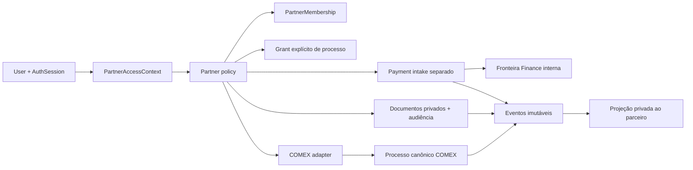

# HiAtlas Partner / Trade Portal V1 — desenho arquitetural

Data: 2026-10-11. Status: escrito e self-reviewed; aguardando aprovação do usuário. Este documento é um desenho, não uma implementação nem um implementation plan.

## 1. Intenção, escopo e base verificada

Permitir que organizações externas de Trade/Trader, despacho aduaneiro, logística, agenciamento de carga e outros parceiros acompanhem e contribuam para processos COMEX explicitamente compartilhados. O parceiro possui login próprio, mas não é colaborador do cliente. O objetivo é registrar informações e evidências com autoria real, substituir comunicação dispersa e permitir acompanhamento restrito, sem abrir o tenant ao parceiro.

Classes conceituais: INTERNAL, TENANT e PARTNER. Classe de ator não equivale a tabela de credenciais nem a cargo profissional. Trade/despachante/logístico são categorias da organização; não concedem direitos por nome.

Base exclusiva verificada antes da criação: `feat/hiatlas-purchase-request-v1`, local e `origin` em `c50353aadba2e1ef6bb0b917b3e63736fa5f1f90`, árvore limpa. Ancestry confirmada sobre Customer Scope `fa354b73cdb43d600949e54b81595f416ef5cd65` e linha Purchase Request iniciada em `450b2b41fd4a0e04cb075f09f99b6ad8dba9bccd`. Repositório: `https://github.com/HiGamer-Jr/Atlas.git`. Worktree exclusiva: `D:/Atlas/.worktrees/hiatlas-partner-portal-v1`; branch `feat/hiatlas-partner-portal-v1`, criada nesse SHA exato. O criador nativo retornou Not a git repository; Git foi utilizado no repositório oficial, após verificar `.worktrees` ignorada.

Resposta explícita do usuário: solicitações de pagamento próprias são as da ORGANIZAÇÃO PARCEIRA, acessíveis apenas aos seus membros com permissão específica. Isso não implica acesso de todos os membros nem acesso a solicitações de outra organização.

Nesta etapa: somente este spec, self-review e commit local. Sem código, migração, dependências, seeds, push da feature, merge, deploy ou alteração em main/Demo. A implementação futura exige aprovação deste spec e depois revisão de um implementation plan.

## 2. Estado atual encontrado no repositório

| Área | Evidência concreta na base | Consequência para o desenho |
|---|---|---|
| Identidade | `backend/app/identity/models.py`: User, AuthSession, SecurityToken, EmailOutbox; Principal em `identity/schemas.py` contém user/session/platform_role | Reutilizar credenciais/sessões é possível; Principal não representa PARTNER hoje |
| Contexto | `tenancy/models.py`: AccessContext ligado a sessão, ator, tenant e contrato; `tenancy/contexts.py` revalida usuários, sessão, contrato, contexto e membership/role | Contexto é referência opaca revalidada; não é token portátil de autorização |
| Tenancy | Membership e TenantRole são scoped a tenant/contract; PlatformRoleAssignment é separado | Não inserir parceiros em Membership/TenantRole ou fabricar role tenant |
| Escopo operacional | `tenancy/operational_scope.py` e schemas retornam somente INTERNAL/TENANT; `organization/unit_authorization.py` aplica ALL/RESTRICTED, viabilidade de ancestrais e limite 1000 | Reutilizar princípios e infraestrutura, não converter unit scope em partner scope |
| Capabilities | `platform/capabilities.py`: catálogo fechado, flags tenant_role/tenant_enabled/module_code; grants internos separados | Nova família de capabilities precisa de política de ator explícita; flag tenant_role não serve a PARTNER |
| Purchase Request | `procurement/requests/*`: agregado, eventos, comandos, itens, atendimento, receipts e anexos reais; rotas `/api/procurement/requests` | Reutilizar padrões, não modelos ou autorização unit-based para logística/pagamento |
| Auditoria | `audit/models.py`, `schemas.py`, `service.py`: eventos imutáveis, snapshots tipados e actions fechadas; actor_role aceita apenas PLATFORM_ADMIN/SUPPORT ou null | PARTNER exige proveniência tipada nova; não colocar PARTNER em actor_role |
| COMEX | `organization/modules.py`: COMEX no catálogo, fora de OPERATIONAL_MODULES; registro central `db/models.py` não contém Process/Container/Port/Vessel/Milestone operacionais | Não há agregado COMEX operacional oficial para compartilhar hoje |
| Data Hub | DataHubPartner, DataHubComexReference e DataHubFinancialForecast em `datahub/models.py`; schemas/catalog importam registros informacionais | Parceiro informacional não é organização autenticada; referência COMEX não é processo; forecast não é pagamento |
| Frontend COMEX | `frontend/src/workspace/catalog.ts` possui menus e registros demonstrativos; não há API COMEX operacional no router central | Não portar menus, valores, navios, containers ou processos demonstrativos |
| Finance | finance.read/fiscal.read sensíveis e domínio operacional FINANCE indisponível; grants financeiros excepcionais não entregam pagamento | Payment Request e futuro executor financeiro têm fronteiras próprias; não relaxar classificação/grants |
| Frontend contextual | AuthProvider, OperationalScopeProvider, ApiClient e sessionStorage de contexto por aba | Manter isolamento de abas, invalidação de callbacks e blobs; capabilities continuam descritivas |

Exploração: registro completo de modelos, rotas centrais, catálogo comercial/capabilities, módulos reais de auth/tenancy/organization/audit/procurement/datahub e ocorrências COMEX/Finance no backend, migrations, frontend e documentos de produto. Não foram encontrados modelos ou rotas operacionais de booking/container/navio/porto/milestones/pagamento. Requisitos/blueprint descrevem intenção; não comprovam implementação. A base possui gate completo validado de 1231 backend/37 scripts/410 frontend, zero skips e cleanup normal; nesta fase documental não foi rerodado nem declarado um novo gate de software.

## 3. Alternativas de identidade e autorização

| Alternativa | Identidade | Autorização | Vantagens | Custos/riscos |
|---|---|---|---|---|
| A — recomendada | User/AuthSession existentes; PartnerMembership e PartnerAccessContext próprios | Grants tipados por recurso, política exclusiva PARTNER e projeções privadas | Reutiliza login, reset, CSRF, sessão, outbox e identidade de auditoria; admite vínculos diferentes sem unir privilégios | Exige guards de classe nas rotas e cuidado com convites/reset compartilhados |
| B — realm externo separado | PartnerUser/PartnerSession e credenciais próprias | Grants igualmente por recurso | Separação de credenciais/cookies mais forte; adequada a realm independente | Duplica lifecycle, rate limits, logout, recuperação e auditoria; risco de controles divergentes/e-mails duplicados |
| C — federação futura | IdP externo por issuer+subject, vinculado a User local | Mesmos PartnerMembership/context/grants locais; claims externos não concedem processo | SSO sem redefinir domínio; reutiliza A | Provisionamento/federação/vinculação confiáveis ainda inexistentes; dependência desnecessária para V1 |

Recomendação: A, com fronteira de autorização explícita. Não adicionar User separado apenas por haver terceira classe. C é evolução possível: nunca vincular contas por e-mail isolado nem aceitar role/tenant/process claims do IdP como autoridade local. Representar parceiro como TenantRole, subtenant fictício ou TemporaryPrivilegedGrant foi avaliado e rejeitado: mistura colaboração externa com acesso interno e cria escalada.

User é identidade de autenticação. A classe efetiva é do contexto validado no servidor. Na V1, usuário com PlatformRoleAssignment ativo não opera contexto PARTNER: permanece INTERNAL, como o bloqueio atual de INTERNAL no Purchase Request. Sem platform role, uma pessoa pode possuir membership TENANT e PARTNER, mas cada contexto escolhe uma relação autorizada e nunca soma capabilities. Duas organizações parceiras exigem contextos independentes. Mudança de platform role invalida a classe esperada na próxima revalidação.

## 4. Componentes e fronteiras

1. Identity mantém credenciais, sessão, CSRF, reautenticação, convites e recuperação. Partner identity binding referencia User real.
2. Partner access mantém organização externa, membros/permissões, relacionamento aprovado com cliente/contrato e contexto opaco.
3. Resource sharing pertence ao cliente: grants de processo real definem ações/publicação. Parceiro não modifica grants.
4. COMEX é proprietário dos processos e fatos logísticos canônicos. Portal usa adapter fechado; não cria cópia paralela de Process.
5. Timeline é evidência imutável do domínio. Partner timeline é projeção autorizada, não acesso ao audit global.
6. Documents mantém conteúdo privado, versões imutáveis e publicação por audiência; pagamento não referencia RequestAttachment de compra.
7. Payment intake registra pedido/documentos. Finance futuro valida/programa/executa e publica status mínimo; PARTNER nunca chama comandos internos.
8. Frontend partner tem provider/rotas/DTOs próprios; reutiliza transporte, ciclo de contexto e tratamento de erros.

Não extrair framework genérico de todos os domínios antecipadamente. Reutilizar pequenas primitives de identidade/transação/digest/arquivos/audit; adapters e políticas permanecem explícitos.

## 5. Identidade, organização, onboarding e contexto

PartnerOrganization representa empresa externa REAL; não é Tenant, OrganizationNode ou DataHubPartner. Pode atender vários clientes. Identidade empresarial criada/verificada por operador autorizado, sem diretório público, enumeração global ou merge automático por nome/documento. Cadastro não confere acesso.

PartnerMembership liga User à organização, com active, blocked, invitation_pending, version. Permissões são codes fechados atribuídos individualmente; não existem TenantRole ou perfis Demo. Membership não concede contrato/processo sem relação e grant. V1 não entrega administração ao parceiro: não convida membros, muda permissions, reativa vínculo ou aumenta escopo por conta própria.

Onboarding V1 é curado: PLATFORM_ADMIN pode provisionar organização/membership e emitir convite sob capabilities dedicadas de lifecycle; PLATFORM_SUPPORT não recebe essas capabilities automaticamente. Provisionamento NÃO permite ler processo nem criar grant em nome do cliente. Vinculação comercial ao contrato exige aprovação de TENANT autorizado e autoria/evidência auditadas. Tenant não lista diretório global nem administra membros compartilhados com outros clientes.

Convite exige alvo PARTNER tipado/FK própria: alvo tenant OU partner exclusivo; não reutilizar membership_id tenant para PartnerMembership. Tokens hash-only, prazo limitado, uso único, recipient/user/organization/membership/issuer vinculados server-side; reemissão cancela anteriores/outbox atomicamente. Token não admite troca de alvo. User existente: convite não altera senha/status/TenantRole/vínculos anteriores; aceitação exige autenticação da conta destinatária. Novo User usa lifecycle de primeira credencial; reset segue política global de identidade e revogação de sessões/contextos. Sem autorregistro público ou associação por e-mail candidato.

PartnerAccessContext é tabela separada de AccessContext V1, preservando Customer Scope. Campos: id UUID opaco, session_id/actor_user_id, partner_organization_id, partner_membership_id, tenant_id/contract_id, client_link_id, access_epoch, created_at/expires_at/revoked_at. TTL não excede sessão/política existente. Sem TenantRole, node/unit ou grants copiados. Namespace `/api/partner/*` aceita apenas contexto PARTNER; rotas tenant aceitam apenas AccessContext. Mesmo header `X-HiAtlas-Context`, dependência específica, sem fallback de tabela ou interpretar ID inexistente como outra classe.

Discovery autenticado retorna apenas organizações do próprio usuário e contratos com client link ativo E pelo menos um grant de processo válido; valida tenant/contract/adapter/módulo antes de revelar contexto operacional. Último grant revogado: discovery omite cliente/contrato, self/context falha fechado e UI elimina dados. Contexto pode persistir até TTL, mas não constitui autorização residual. Não usar `/api/contracts` interno como discovery partner.

## 6. Compartilhamento de recursos e dados propostos

| Entidade proposta | Campos/regras essenciais | Autoridade |
|---|---|---|
| PartnerOrganization / partner_organizations | UUID, nome real, categorias informativas fechadas, active, version; sem hard delete de evidência | Lifecycle curado |
| PartnerMembership / partner_memberships | organization_id,user_id,active/blocked/pending,version; unique(org,user); histórico revogado | Lifecycle curado |
| PartnerMembershipPermission | org/member/code/active; FK composta/catálogo PARTNER exclusivo | Lifecycle curado |
| ContractPartnerLink | tenant/contract/org,status ACTIVE/REVOKED,version,access_epoch,aprovação/evidência; unique scoped | TENANT autorizado |
| PartnerAccessContext | Sessão/usuário/member/link/access_epoch/tenant/contract e prazo | Servidor |
| PartnerProcessGrant | tenant/contract/process/org/link,active/revoked_at/expires_at,version,grant_epoch | TENANT autorizado |
| PartnerProcessGrantPermission | FK composta de grant+capability; delegação explícita, sem wildcard | TENANT autorizado |
| PartnerProcessPublication | process/org/epoch,version,schema_version, projeção allowlisted; não copia processo/autoridade | COMEX/publicação cliente |
| ProcessEvent e publicação | Evento canônico imutável + audiência explícita; sequência canônica privada | Domínio proprietário |
| ProcessDocument / DocumentAudience | Scoped processo/org criadora, autor/member,tipo,digest,tamanho,conteúdo privado,scan status,version; audiência por org | Dono/publicador autorizado |
| PartnerPaymentRequest/events | processo/tenant/contract/org/autor/member,version,valor/moeda/documentos,status intake; estado financeiro publicado separado | Intake e Finance distintos |
| PartnerCommandReceipt | sessão/contexto/ator/org/tenant/contract/route/target/key,digest,response/status, dependências de divulgação | Transação do comando |

PartnerProcessGrant é preferido ao genérico PartnerResourceGrant: V1 só compartilha COMEX e FK real é verificável. Não usar resource_type/resource_id sem FK polimórfica como atalho. Novos tipos exigem grants/adapters próprios ou registro fechado com integridade demonstrável em fase específica.

FKs compostas tenant/contract/process impedem cross-contract/tenant; org/member/link/epoch impedem cross-partner. Processo não migra de tenant/contract mantendo grants. Grant é de organização e processo exatos, nunca ALL, wildcard de unidade ou herança de processo futuro. Sharing não concede Purchase Request de origem, fornecedor completo, custos, árvore interna, outro parceiro ou todos os anexos.

Autorização = identidade/sessão/contexto PARTNER válidos ∩ organização/membership/permission ativas ∩ tenant/contract/link ativos ∩ grant atual ∩ ações delegadas ∩ módulo/adapter/estado ∩ audiência do subrecurso. Documentos/pagamento adicionam políticas próprias. Tudo server-calculated.

Revogação é terminal por epoch: reativar organização/membership/link não reativa grants. Recompartilhar exige epoch novo e definição explícita de ações/publicações/documentos, default vazio; contexto/receipt antigo não recupera acesso. Preservar fatos/histórico, não apagar revogação.

## 7. Fronteira COMEX e dependências

O repositório ainda não possui Process, Container, Port, Vessel ou Milestone operacionais. DataHubComexReference é referência informativa, não processo autorizado; menus e registros do Workspace não são domínio oficial. Uma COMEX Process Foundation, com desenho próprio aprovado, deve fornecer identidade scoped de processo, versão, estados, componentes logísticos, eventos e publicação antes de habilitar operações do portal. Esta proposta define a fronteira consumidora, não inventa uma tabela de processo para contornar a dependência.

Adapter fechado: resolve_process_scoped; authorize_tenant_share; partner_projection; apply_partner_logistics_command; append_event; revalidate_after_wait. Cada método mantém tenant/contract/process, regras do domínio, audiência e versões. A habilitação exige implementação real e testes dessas invariantes. Ausência de adapter ou domínio resulta em PARTNER_DOMAIN_UNAVAILABLE e controles bloqueados. Não adicionar COMEX a OPERATIONAL_MODULES apenas porque login e grants existem.

O cliente que compartilha usa contexto TENANT, TenantRole customizada, capability COMEX e unit scope real do processo. O parceiro usa grant de recurso, nunca unit scope. Mudança de unidade interna não amplia grant nem expõe catálogo interno. Migração de DataHub exige identidade/proveniência verificadas e decisão explícita; não converte parceiro informativo em organização autenticada.

Booking, containers, viagens, portos e milestones pertencem ao COMEX canônico, com múltiplos containers/trechos quando necessário. Não criar PartnerContainer ou cópias do processo. Informações reportadas sem cadastro correspondente são fatos tipados com proveniência; não fabricam IDs de catálogo. A cadeia logística fornecida é narrativa, não máquina linear obrigatória: aéreo, LCL, etapas não aplicáveis e eventos fora de ordem precisam ser suportados pelo domínio proprietário.

## 8. Capabilities e módulos

Nomes propostos seguem o padrão pontuado do catálogo atual, mas constituem família PARTNER exclusiva, sem TenantRolePermission:

| Capability | Limite |
|---|---|
| partner.processes.read | Projeção dos processos compartilhados |
| partner.timeline.read | Eventos próprios/publicados para a organização |
| partner.logistics.update | Campos/componentes delegados pelo grant |
| partner.processes.closure_report | Reportar conclusão; não encerrar Finance |
| partner.documents.create | Upload privado no processo autorizado |
| partner.documents.read | Documentos cuja audiência inclui a organização |
| partner.payment_requests.create | Criar rascunho da organização |
| partner.payment_requests.read_org | Ler solicitações da organização em processos autorizados |
| partner.payment_requests.submit | Enviar intake documental |
| partner.payment_requests.withdraw | Retirar quando o estado permitir |

Permissão da membership é teto, intersectado com ações do grant. Mutações exigem também a leitura correspondente; create não concede implicitamente read_org. Categorias Trade/despachante/logística não distribuem permissões automaticamente. Catálogo desconhecido falha fechado. Não existem capacidades PARTNER de aprovação, execução financeira, administração, alteração de TenantRole ou ampliação do próprio escopo.

Para TENANT, propor comex.processes.read/share/publish/logistics.validate/close, cada qual vinculada a módulo COMEX e escopo real. Roles customizadas recebem capabilities sem perfil histórico da Demo. share não concede aprovação financeira. Lifecycle interno usa partners.organizations.manage e partners.memberships.manage, explicitamente sensíveis/administrativas; não concede leitura dos processos e não é atribuído automaticamente a PLATFORM_SUPPORT ou comprador.

COMEX contratado, ativo e operacional é necessário. Payment intake fica desabilitado por padrão e exige COMEX operacional, FINANCE comercial contratado/ativo e serviço de intake real habilitado. Isso não habilita o módulo Finance operacional inteiro nem contorna guards atuais: um adapter específico deve demonstrar a fronteira. Sem ele, nenhuma solicitação financeira é criada. Executor financeiro completo pode ser entregue posteriormente; estados programado/pago nunca são simulados.

Capabilities devolvidas ao portal são descrições server-calculated para UX, não provas reutilizáveis de autorização. Cada operação recalcula identidade, contexto, grant, módulo, subrecurso e capability.

## 9. Contratos de API propostos

Contratos abaixo são desenho, não endpoints já existentes. Cookie/session, CSRF e X-HiAtlas-Context opaco permanecem. DTOs fechados rejeitam campos de autoridade como tenant, contract, actor, role, organization ou status escolhidos pelo browser. IDs permitidos são candidatos que o servidor valida.

| Método/rota sob /api | Contrato |
|---|---|
| GET /partner/access-options | Memberships próprias e vínculos com acesso efetivo; sem diretório global |
| POST /partner/contexts | membership_id e client_link_id candidatos; valida vínculo, módulos e grants atuais |
| GET /partner/context | schema_version, actor_kind PARTNER, contexto/prazo, organização/membership e cliente/contrato mínimos; sem TenantRole/unidades |
| DELETE /partner/contexts/{id} | Revogar somente contexto da própria sessão |
| GET /partner/processes | Filtrar autorização antes de count/paginação |
| GET /partner/processes/{id} | Projeção publicada, versão externa, disponibilidade e capacidades descritivas |
| GET /partner/processes/{id}/timeline | Eventos visíveis; cursor opaco sem sequência/contagem privada |
| POST /partner/processes/{id}/logistics-updates | Evento discriminado, componente candidato, tempo, motivo, evidências e expected_version |
| POST /partner/processes/{id}/closure-reports | Relato com evidência; encerramento canônico é decisão TENANT |
| GET/POST /partner/processes/{id}/documents | Lista autorizada/upload privado com categoria e versão |
| GET /partner/processes/{id}/documents/{document_id}/content | Bytes autenticados; sem URL pública |
| POST /partner/processes/{id}/payment-requests | Rascunho próprio: valor decimal, moeda, documentos, justificativa e versão inicial 0 |
| GET /partner/processes/{id}/payment-requests | Da organização, com read_org e grant atual |
| GET/PATCH /partner/processes/{id}/payment-requests/{request_id} | Ler/editar rascunho; não trocar organização/processo/beneficiário |
| POST .../payment-requests/{request_id}/submit ou /withdraw | Transição fechada, expected_version e idempotência |
| POST /comex/processes/{id}/partner-grants | TENANT: vínculo aprovado, ações/publicações explícitas e versão inicial 0 |
| PATCH .../partner-grants/{grant_id} | TENANT: substituir permissões atomicamente com versão/motivo; não reativar epoch revogado |
| POST .../partner-grants/{grant_id}/revoke | TENANT: revogação, versão, auditoria e invalidação atômicas |

Comandos de negócio exigem Idempotency-Key UUID e expected_version da entidade/projeção correta. Context creation usa namespace próprio user/session/route/candidatos/key, pois ainda não existe contexto; fechamento de contexto é idempotente por identidade. Não reutilizar o receipt de negócio para fabricar contexto inicial. Listas: 50 por página, máximo 100, cursor máximo 2048 caracteres; limites configurados/testados server-side. Não devolver uma árvore ou snapshot de autorização parcialmente truncado: excesso de payload obrigatório gera erro explícito e bloqueio. Paginação explícita de recursos autorizados não é truncamento silencioso de escopo.

Erros: 401 SESSION_INVALID; 403 CONTEXT_REQUIRED/CONTEXT_INVALID/ACTOR_CLASS_DENIED/CAPABILITY_DENIED; 404 uniforme para recurso inexistente, estrangeiro ou não compartilhado; 409 VERSION_CONFLICT/IDEMPOTENCY_CONFLICT/STATE_CONFLICT; 422 INPUT_INVALID/EVENT_NOT_APPLICABLE; 413 limites de arquivo; 503 PARTNER_DOMAIN_UNAVAILABLE. Mensagens não refletem dados privados. Respostas privadas usam Cache-Control: no-store. Contrato PARTNER é próprio/versionado; não mudar silenciosamente a união INTERNAL/TENANT do operational-scope V1.

## 10. Atualizações logísticas e timeline

Eventos candidatos fechados: BOOKING_REPORTED, CONTAINER_REPORTED, VESSEL_REPORTED, ETD_UPDATED, ETA_UPDATED, ORIGIN_ARRIVAL_REPORTED, DEPARTURE_REPORTED, DESTINATION_ARRIVAL_REPORTED, CUSTOMS_RELEASE_REPORTED, FREE_TIME_REPORTED, EMPTY_RETURN_DEADLINE_UPDATED, DELIVERY_REPORTED, EMPTY_RETURN_REPORTED, PROCESS_CLOSURE_REPORTED e CORRECTION_REPORTED. O adapter COMEX valida aplicabilidade, componentes e campos delegados; não aceita atualização genérica de status/custo/câmbio/financeiro.

recorded_at é relógio do servidor; occurred_at é informação reportada. ETD/ETA usam instantes timezone-aware; prazos civis registram data, timezone/local e semântica. Free time registra intervalo/base/condições, sem automatizar demurrage ou cálculos financeiros. Classificação fechada de campos delegáveis deve ser definida na COMEX Foundation: fatos críticos de desembaraço, documentos e fechamento permanecem reportados até validação TENANT; não existe política arbitrária enviada pelo navegador.

Evento canônico imutável registra ID, tenant/contract/process, sequência privada, versão canônica, schema_version, tipo, actor_kind, user_id, membership tipada, organização parceira quando aplicável, contexto/sessão/request_id privados, tempos, before/after tipados, motivo, evidence IDs/digests e audit_event_id. Snapshots históricos mínimos preservam identificação mesmo após revogação. Correção é novo evento que referencia o anterior, nunca edição do histórico.

Timeline PARTNER inclui eventos da própria organização e eventos internos explicitamente publicados. Não expõe ator de outro parceiro, custos, comentários internos ou sequência canônica. Um fato informado por outra organização só pode aparecer por publicação TENANT de projeção de negócio redigida, sem identidade/evento original. Before/after e evidências também passam por audiência; publicar evento não publica automaticamente todos os seus campos/anexos.

Relato, aceitação do fato e encerramento são conceitos distintos. PROCESS_CLOSURE_REPORTED registra o relato do parceiro. TENANT autorizado decide encerramento canônico, condicionado às invariantes COMEX; não encerra pagamentos pendentes por consequência implícita.

## 11. Documentos privados e NF/NFS

Reutilizar primitivas seguras de Purchase Request, não sua entidade nem sua política de autorização: bytes privados, limite real durante streaming, digest, validação conservadora de formato, filename seguro, leitura autenticada e evidência imutável. Documento pertence ao processo scoped, organização criadora/autor e versão; DocumentAudience é explícita.

Limites iniciais propostos: 5 MiB por arquivo, corpo até limite + 64 KiB de envelope, dez documentos/evidências por comando/publicação e quota de 100 MiB por processo/organização, incluindo versões retidas. Excesso falha atomicamente; não reiniciar quota por supersession. MIME inicialmente PDF conservador, PNG, JPEG e texto seguro. Categoria BUSINESS_SPECIFICATION/LOGISTICS_EVIDENCE/NF/NFS/PAYMENT_RECEIPT é separada do MIME. NF/NFS em PDF é declaração documental, não validação fiscal. XML assinado, ZIP, PDF criptografado e formatos não suportados ficam deferred e são rejeitados explicitamente.

Para arquivos externos, recomendar QUARANTINED -> AVAILABLE/REJECTED por scanner adapter real. Parser atual não equivale a antivírus. Sem scanner, documento permanece em quarentena, sem download, publicação, uso como evidência ou submissão financeira; não fabricar resultado clean. Essa é exigência da futura implementação do portal, sem alterar retrospectivamente Purchase Request nesta fase. Conteúdo bytea privado pode ser reaproveitado sob quota; evolução para object storage exige adapter privado, sem URLs públicas ou links reutilizáveis de download.

Default de documento criado pelo parceiro é audiência da própria organização, ainda exigindo document capability e grant do processo. Documentos do cliente/comprovantes financeiros exigem audiência explicitamente publicada àquela organização. Compartilhar processo não compartilha todos os anexos. Evidência estrangeira, revogada, em quarentena ou sem audiência é negada inclusive em replay.

Documento usado em submissão/evento não pode ser apagado para reescrever evidência: substituição cria nova versão/correção. Retenção e eventual tombstone são workflow auditado futuro. Download usa attachment, nosniff, no-store e nome seguro. Revogação bloqueia a próxima leitura; bytes já entregues não podem ser recolhidos. Frontend revoga blob URLs e referências locais ao mudar contexto.

## 12. Payment Request: domínio separado

Purchase Request representa necessidade interna de compra e autorização TENANT/unit-based. PartnerPaymentRequest representa intake financeiro/documental de organização externa ligado a processo compartilhado; não reutiliza máquina de estados, approval_policy ou fulfillment de Procurement.

Modelo: UUID/referência própria, tenant/contract/process/org, autor e membership, contexto de origem, version, valor positivo decimal exato Numeric(20,4), moeda de catálogo fechado BRL/USD/EUR/GBP/CNY, documentos autorizados, descrição/justificativa e due_on. Wire usa decimal como string; não float, câmbio fictício ou conversão automática. Beneficiário é organização verificada server-side; dados bancários/instruções de pagamento pertencem à futura fronteira Finance, sem campo livre que altere beneficiário.

Estados intake: DRAFT -> SUBMITTED; DRAFT/SUBMITTED -> WITHDRAWN quando Finance ainda não assumiu execução; SUBMITTED -> CHANGES_REQUESTED/ACCEPTED_FOR_FINANCE/REJECTED por validador interno; CHANGES_REQUESTED -> SUBMITTED com nova versão/evidências. Withdraw após aceite depende de decisão financeira futura e não é permitido na V1. Terminal não reabre; nova solicitação pode referenciar anterior. PATCH só edita DRAFT ou campos expressamente devolvidos em CHANGES_REQUESTED; submissão conserva snapshot imutável. Validador TENANT não pode validar uma solicitação que ele próprio enviou na identidade PARTNER.

Status financeiro publicado é dimensão separada: NONE/PENDING/SCHEDULED/PAID/REJECTED, vindo exclusivamente de Finance real. ACCEPTED_FOR_FINANCE não é aprovação nem execução de pagamento. Upload de NF/NFS/comprovante pelo parceiro não muda status para pago. Sem adapter financeiro, não produzir SCHEDULED/PAID nem comprovante sintético.

Conforme decisão do usuário, solicitações próprias são da organização: leitura exige read_org individual, grant atual do processo e audiência; autoria isoladamente não dispensa permissão. Não expor solicitações de outros parceiros, de processos não compartilhados, orçamento, contabilidade ou pagamentos gerais do tenant.

Revogar compartilhamento bloqueia também consulta das solicitações vinculadas, mesmo que pagamento esteja pendente; workflow interno e histórico continuam preservados. Acesso pós-revogação independente exigiria grant próprio de recurso financeiro em fase futura, sem exceção implícita agora. Processo encerrado pode manter compartilhamento explicitamente read-only pelo cliente, nunca acesso permanente automático.
## 13. Revogação e isolamento

Cada acesso recalcula usuário/sessão/idle timeout, classe de contexto, organização/membership/permissões, contexto, tenant/contract, vínculo, processo, módulo/adapter, grant/epoch/expiração e audiência do subrecurso. Cache, receipt, capacidade descritiva e UUID enviado não são autoridade. Inativação de qualquer dependência bloqueia a próxima revalidação.

ContractPartnerLink possui access_epoch, copiado no PartnerAccessContext. Revogação de grant ou vínculo incrementa access_epoch no mesmo commit e invalida contextos anteriores daquele vínculo, mesmo quando outros grants permanecem: é escolha conservadora explícita. Recompartilhamento exige novo grant_epoch e nova seleção de contexto; não ressuscita contexto, receipt ou audiência antigos. Reativação de organização/membership não reativa grants nem contextos revogados. Mudanças de permissões revalidam imediatamente; substituição é atômica, com expected_version e auditoria, sem estado intermediário ou reativação de permissões dormentes.

Predicados scoped e FKs compostas protegem tenant/contract/org/process; UUID não substitui autorização. Filtros precedem count, paginação, pesquisa, timeline e conteúdo. Respostas não revelam existência de vínculo/recurso estrangeiro. Cliente/contrato são mínimos e conhecidos somente por compartilhamento válido; não há árvore de unidades, contatos de outras organizações ou acesso ao audit global. Revalidar tempo após qualquer espera em locks, inclusive expiração de sessão, contexto e grant.

## 14. Auditoria, concorrência e idempotência

Comandos usam a unidade transacional existente de get_db/db.begin e runtime PostgreSQL de privilégio mínimo. Mutação, versão, evento de domínio, auditoria e receipt são gravados no mesmo commit; falha em qualquer parte faz rollback completo. Eventos de negação de segurança, quando necessários, são registrados após rollback por caminho próprio, sem confirmar existência de recurso estrangeiro.

Estender contratos tipados/versionados de AuditInput/actions/entity types com actor_kind, partner_org_id, membership tipada, vínculo e grant_epoch. actor_role permanece papel de plataforma ou NULL; nunca escrever PARTNER como TenantRole/platform role. Eventos antigos conservam sua representação, sem inferir automaticamente classe a partir de NULL. Campos auditáveis usam snapshots fechados e digests; textos/documentos privados permanecem no domínio sob audiência, sem despejo de JSON livre no log. Histórico do parceiro não implica audit.read. Append-only e proteções de runtime continuam obrigatórias.

Ordem de locks proposta preserva lifecycle/operator advisory locks atuais, depois usuários ordenados, sessão, tenant/contract, contexto, organizações parceiras ordenadas, membership/permissões, vínculo, processo canônico, grants/publicações ordenados, subrecursos e receipt. Alterações de sharing/lifecycle obedecem à mesma ordem e bloqueiam o vínculo antes do processo. Não inverter ao revogar. O locking de Contract existente pode limitar throughput; medir e testar antes de qualquer otimização.

Linearização explícita: revogação que comita antes da autorização bloqueia operação. Operação que já detém locks conflitantes pode comitar antes da revogação que espera; o acesso seguinte é bloqueado. Não prometer cancelamento retroativo de commit. Testes PostgreSQL com barreiras cobrem ambas as ordens e expiração durante espera.

expected_version acompanha entidade mutada. Projeção externa possui versão própria por organização/grant_epoch, distinta da versão canônica privada; atividade interna não publicada não incrementa versão externa nem revela volume de eventos. Comando logístico bloqueia processo e publicação, verifica versão externa, aplica apenas campos delegados sobre estado canônico atual e revalida invariantes; nunca substitui processo inteiro pelo snapshot do browser. Outras organizações só recebem bump quando mudança é publicada para elas.

Receipt de negócio é único por tenant/contract/org/member/user/session/context/grant_epoch/route/target/key, incluindo semântica NULLS NOT DISTINCT para criação. Digest canônico cobre body, versão, IDs de evidência e hashes de bytes. Mesma chave/body retorna resposta/status originais sem novo efeito; payload diferente gera 409 após autorização atual. Contextos de duas abas possuem namespaces independentes.

Antes de replay, recalcular permissão atual da ação e de todas as dependências do snapshot original: processo, organização, epoch, documentos/audiências, solicitações e campos publicados. Não liberar receipt antigo porque a projeção atual parece autorizada. Grant/audiência revogados negam replay; nova epoch não recupera receipt anterior. Replay de comando já concluído não exige que a entidade ainda esteja no estado de origem da transição: valida autoridade/divulgação atuais e retorna resultado original, sem executar novamente a máquina de estados. Não embutir bytes de documentos no receipt. Retenção de receipts precisa preservar unicidade; expiração/limpeza não pode permitir reexecução silenciosa da mesma chave.

## 15. Fronteira frontend

Portal PARTNER usa DTO/provider/rotas próprios e transporte autenticado existente, sem catálogo Demo. Descoberta real fornece organizações, vínculos e processos permitidos. Não inferir PARTNER de platform_role NULL, nem alterar implicitamente operational-scope TENANT V1. A camada reutilizável distingue classe, contexto, versão externa, capacidades descritivas e disponibilidade do domínio.

Somente ID opaco de contexto pode persistir em sessionStorage por aba, seguindo padrão existente; nenhuma autorização em localStorage. Schema, estado ou capability desconhecidos, payload obrigatório inválido e adapter indisponível bloqueiam controles e exibem estado claro. Seleção de contexto limpa views, drafts, referências de arquivos e blob URLs; generation/abort guards impedem resposta tardia do contexto A de entrar no B. Cada comando captura contexto/versão/chave da intenção original.

Duas abas não trocam contexto por estado global. 403/404 de revogação invalidam controles e dados relevantes; 409 exige leitura/reconciliação explícita, sem auto-merge ou repetição com nova chave. Retry da mesma intenção preserva chave. Logout/reset de sessão invalidam superfícies de todas as classes. Nada reconstrói UI operacional com nomes, empresas, unidades ou valores fictícios.

## 16. Plano de testes de aceitação

Esta matriz é requisito do desenho, não implementation plan.

| Área | Casos obrigatórios |
|---|---|
| Identidade | Mesmo User com contextos TENANT/PARTNER sem união de permissões; INTERNAL não opera como PARTNER; headers de outra classe negados |
| Onboarding | Convite vinculado a destinatário/org/membership; uso único; reissue invalida anterior; pending sem acesso; preservar credenciais/vínculos existentes; reset/logout revoga sessões/contextos |
| Recursos | Dois tenants, contratos e parceiros; somente processo compartilhado; unit scope ALL não autoriza PARTNER; múltiplas organizações próprias isoladas; nenhum acesso por vínculo sem grant |
| Capabilities | Interseção member/grant; role TENANT customizada compartilha somente unidades próprias; catálogo desconhecido nega; nenhuma operação PARTNER de aprovação/execução/admin |
| Módulos | COMEX comercial sem adapter nega; Finance/intake ausente ou inativo bloqueia payment request; nenhum fallback DataHub/Demo |
| Revogação | User/session/org/member/role de plataforma incompatível/permissão/link/grant/contexto/módulo/contrato/audiência inativos bloqueiam próximo acesso; reshare exige nova epoch/contexto; histórico dormante não reativa |
| Consultas | Filtrar antes de contagem/paginação; cursor estrangeiro rejeitado sem leak; 404 uniforme; não expor unidades/contatos/atividades de outro parceiro |
| Logística | Aéreo sem container, múltiplos componentes, fatos fora de ordem, datas/timezones/prazos, campos delegados; relato de fechamento não fecha Finance; DataHubReference não vira Process |
| Timeline | Ator/org/tempo/before-after/evidência reais; somente próprios/publicados; audiência por campo/documento; histórico imutável e correção append-only |
| Arquivos | Tamanho real mesmo sem Content-Length; formato/PDF conservador/filename; quota com versões; scanner ausente mantém quarentena; cabeçalhos privados; IDs/evidências cross-scope negados; versão submetida imutável |
| Payment requests | read_org por membro obrigatório, autoria não basta; outra org/processo negados; transições/versionamento; beneficiário/status financeiro não enviados como autoridade; NF/NFS não aprova/paga; validador não valida próprio envio |
| Atomicidade | Falha audit/event/receipt causa rollback de tudo; FKs cross-scope e runtime append-only preservados; alteração de grants/epoch sem janela intermediária |
| Concorrência | PostgreSQL real com barreiras: mesma chave um efeito, versões conflitantes 409, revoke/op em ambas as ordens, expirations após espera, locks sem inversão, versão externa sem revelar evento privado |
| Replay | Resultado original sem efeito duplicado; body diferente 409; revalidar audiência original/grant atual; novos contextos/epochs não recuperam receipt antigo; estado final não impede replay autorizado |
| Frontend | Duas abas independentes, troca de contexto com resposta/callback tardios, limpeza de blobs/drafts, unknown/invalid state fail-closed e ausência de cache de autorização em localStorage |

Execução futura mantém database_harness PostgreSQL, sem SQLite, bypasses ou skips. Exigir gate oficial completo .\scripts\check-local.ps1 -PostgresRoot 'D:\Atlas\.tools\pgsql18': backend, frontend, scripts, lint, TypeScript/Vite, git diff --check e cleanup PostgreSQL PASS. Esta etapa altera somente documentação e não alega execução nova desse gate.

## 17. Riscos e itens deferred

COMEX operacional ausente é dependência bloqueante explícita: aprovar sua Foundation antes de implementar sharing operacional. Finance executor, aprovação/programação/execução, dados bancários, validação fiscal, câmbio, demurrage, ERP e reconciliação ficam fora desta V1. Intake não pode simular esses resultados.

Identidade compartilhada exige guards de classe e convites rigorosos. Organização global requer onboarding curado e evita que um tenant administre membros que atendem outros clientes. Federação/MFA e self-service de parceiros exigem desenho próprio. Publicações e audiência por organização aumentam complexidade, mas são necessárias para impedir vazamento. Locks de Contract podem serializar operações; não relaxar antes de testes e medição.

Scanner externo é dependência de disponibilização de arquivos; validar PDF não prova ausência de malware. Armazenamento bytea, versões e receipts crescem: quota/retention precisam preservar auditoria e unicidade. Timeline prova quem informou, quando e com qual evidência; não garante verdade material do relato.

Deferred: catálogo COMEX operacional completo, automatização estoque/transferência/pedido de compra, grants financeiros independentes pós-revogação, wildcard sharing, notificações, dashboards, módulos sintéticos, atores fictícios e qualquer configuração DeploymentBanner/Demo. Nenhuma implementação de PARTNER, migração, endpoint ou alteração de comportamento integra este commit documental.

## 18. Self-review de consistência e gate

Revisão realizada sobre o desenho e as fontes inventariadas:

- Cobertura: estado atual (2), alternativas/recomendação (3), componentes (4), identidade (5), sharing/modelo (6), COMEX (7), capabilities (8), APIs (9), timeline (10), documentos (11), pagamento (12), revogação (13), auditoria/concorrência/idempotência (14), frontend (15), testes (16), riscos/deferred (17).
- Separação: User reutilizado sem TenantRole artificial; contexto determina classe; INTERNAL preservado; operational-scope TENANT V1 não recebe união ambígua.
- Autoridade: PARTNER resource-based; cliente compartilhador usa operational scope real; capabilities UX não autorizam operações; IDs candidatos e adapters ausentes falham fechado.
- Finance: leitura da organização exige permissão individual, conforme resposta do usuário; parceiro só solicita/acompanha, nunca aprova/executa; Purchase Request permanece separado.
- Privacidade: processo não publica todos os documentos/eventos; before/after, evidências e versões externas não revelam outros parceiros; arquivo externo sem scanner permanece indisponível.
- Revogação: grant_epoch e access_epoch resolvem reativação/contextos antigos; mudanças atômicas; linearização não promete cancelar bytes/commits já entregues.
- Replay: exige autoridade atual e autorização do snapshot original, preservando resposta original; estado posterior não reexecuta transição nem inutiliza retry válido.
- Integridade: histórico append-only, expected_version, evento/audit/receipt no mesmo commit e ordem de locks comum; sem relaxar harness.
- Estado atual: registros/model registry/router confirmam ausência de COMEX/Finance operacionais; não tratar referências DataHub ou menus como entrega real.
- Escopo: documento arquitetural, sem código ou implementation plan; dependências/deferred explícitos, sem placeholders de decisão essenciais.

Written spec aguarda aprovação do usuário. Somente após essa aprovação poderá começar writing-plans, com plano apresentado para revisão antes de execução. Branch exclusiva permanece local: nenhum push, merge, deploy ou alteração de main/Demo nesta etapa.
